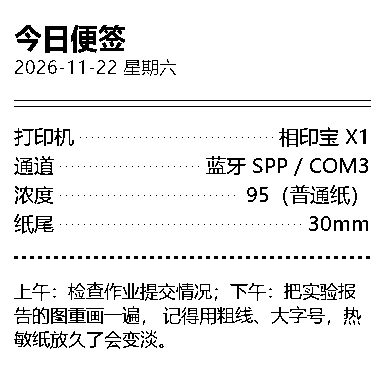
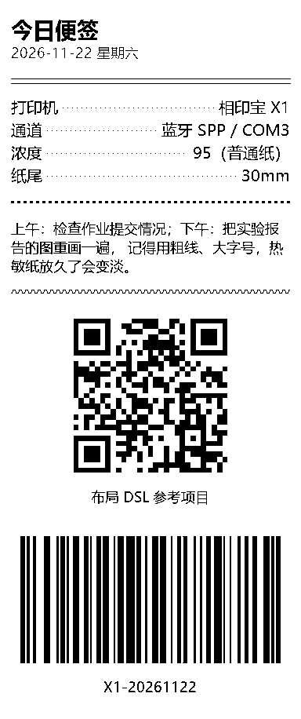

# x1print · 相印宝 X1 Windows 直连打印

> 不用官方 App，Windows 直接通过蓝牙驱动得力「相印宝 X1」（HPRT 方案）打印文字、图片、PDF、二维码和条码。
> 协议是逆向出来的：`docs/protocol.md`。



[](https://www.python.org/)
[](https://github.com/yhn666/xiangyinbao-x1-tool/actions/workflows/ci.yml)
[](#)
[](LICENSE)

## 特性

- **经典蓝牙 SPP 通道**（官方 App 同款），虚拟串口整帧灌入，出纸连续不丢行
- 找不到串口时自动退回 **BLE**，用「突发 + 停顿」的节奏喂数据，实测 ≈11 KB/s 稳定
- 文字：自动换行、中文渲染、字号下限 14（203dpi 下再小就看不清）
- 图片：Otsu 阈值 / Floyd–Steinberg / Bayer 8×8 / 硬阈值四种二值化，照片默认「平滑 + FS」
- PDF：逐页渲染（203dpi）打印
- 二维码、CODE128 条码，可与文字拼在同一张
- 轻量 **YAML 布局 DSL**：`title / text / divider / kv / qr / barcode / image / space`，三套主题
- 浓度按纸张预设（普通纸 95 / 不干胶 75），纸尾距离可调
- `--preview` 输出「即将发送的 1:1 黑白位图」，屏幕所见即纸上所得；`--no-print` 可离线预览

## 安装

```powershell
git clone https://github.com/yhn666/xiangyinbao-x1-tool
cd xiangyinbao-x1-tool

# 方式 A：直接跑
python -m pip install -r requirements.txt
python x1print.py --version

# 方式 B：装成命令（推荐）
python -m pip install -e .
x1print --version
```

需要一台带蓝牙的 Windows 电脑（BLE 4.0 以上）。Linux/macOS 也能跑 BLE，但字体和蓝牙串口的体验以 Windows 为主。

## 开始用

```powershell
# 1) 打印机开机，Windows 设置里配对一次（之后开关机都不用再配）
#    配对后会出现一个「蓝牙链接上的标准串行」COM 口，工具会按 MAC 自动找到

# 2) 扫描并记住设备（可选，配对后也能直接连）
python x1print.py --scan

# 3) 查状态
python x1print.py --status

# 4) 打印
python x1print.py "你好，相印宝"
python x1print.py 便签.txt
python x1print.py --image 图.png
python x1print.py --image 照片.jpg --mode photo
python x1print.py --pdf 文件.pdf
python x1print.py "取件码 1234" --qr "https://example.com" --qr-caption "扫码查看"
python x1print.py --barcode "X1-20261122" --barcode-caption "X1-20261122"
python x1print.py --layout examples/note.yaml
```

也可以双击 `x1print.bat` 用同样的参数。

### 常用参数

| 参数 | 说明 | 默认 |
|---|---|---|
| `--paper plain/sticker` | 按纸张给浓度：普通纸 95 / 不干胶 75 | 沿用打印机保存值 |
| `--density light/middle/dark` 或 `0~100` | 浓度 | — |
| `--gap-mm` / `--feed` | 打印后纸尾距离（1 行 = 3mm） | 30mm（官方值） |
| `--shift-mm` | 整幅水平平移（正=右） | −0.5mm（本机纸窄 1mm 的补偿） |
| `--mode text/photo/bayer/hard` | 二值化方式 | `text`（Otsu） |
| `--font` | 文字字号 | 30（下限 14） |
| `--preview` / `--no-print` | 存 1:1 黑白位图 / 只预览不打印 | — |
| `--ble` | 强制走 BLE，不用蓝牙串口 | 否 |

## 布局 DSL

```powershell
python x1print.py --layout examples/note.yaml --preview
```

```yaml
theme: minimal          # minimal / classic（双线框+宋体）/ notebook（横线底纹）
margin: 14
gap: 10
blocks:
  - type: title
    text: 今日便签
    subtitle: 2026-11-22 星期六
    size: 28
  - type: divider
    style: double        # line / dots / double / wave
  - type: kv
    items:
      - [打印机, 相印宝 X1]
      - [浓度, 95]
  - type: text
    text: 一段正文，自动换行
    size: 18
    align: left          # 或 center
  - type: qr
    data: https://example.com
    caption: 扫码查看
  - type: barcode
    data: X1-20261122
    caption: X1-20261122
  - type: image
    src: photo.jpg
    height: 160
    fit: cover           # cover / contain
    border: true
  - type: space
    mm: 3
```



## 工作原理（一句话版）

官方 App 打印走经典蓝牙 SPP（RFCOMM），把整页渲染成 384 点宽的 1bpp 位图，
按 30 行一包用私有帧协议发给打印机。本项目复刻了这条链路：

```
0x02 | cmd | pkg | len(LE16) | payload | crc32(LE32) | 0x03
```

连接后先用 `cmd=0x18` 交换 CRC 密钥；位图 `cmd=0x00`；浓度 `0x19`；走纸 `0x1A`（行数 × 24 点）。
完整细节见 [docs/protocol.md](docs/protocol.md)。

## 已知限制

- 只针对 **X1 / X1B**（2 寸 384 点）。X3/X4/X7 是另一套指令集，未支持。
- 走纸命令是"相对"的：打印机不知道纸头在哪，纸尾 30mm 是按官方值算的。
- 一次只服务一台主机：手机上 App 连着打印机时，电脑这边会打不出来。
- 203dpi + 1bpp 是天生的：照片有颗粒感，正常阅读距离（30cm 外）观感尚可。
- 不干胶与普通纸的差别只在物理和吃热程度，协议里没有纸张类型指令。

## 目录

```
x1.py              # 协议帧 / 两种传输（基类共用握手与打印逻辑）/ 位图 / 文字 / 二维码条码
layout.py          # YAML 布局 DSL（仅 Pillow + PyYAML）
x1print.py         # 命令行入口（也可 pip install -e . 后直接 x1print）
pyproject.toml     # 打包与依赖
examples/          # 布局示例
tests/             # 不需要打印机的单元测试
tools/             # 标定卡、纸尾标定这类一次性脚本
docs/              # 协议笔记 + 截图
.github/workflows/ # CI：pytest + 布局渲染冒烟
```

## 开发与测试

```powershell
python -m pip install -e ".[dev]"
python -m pytest -q      # 8 个用例，全部不需要接打印机
```

CI（GitHub Actions）在 `ubuntu-latest` 上跑同一套用例和一次布局渲染冒烟，不需要真机。

## English

A Windows-friendly Python driver for the Deli **XiangYinBao X1** (HPRT OEM) 58mm thermal printer.
It speaks the printer's private frame protocol (`0x02 | cmd | pkg | len | payload | crc32 | 0x03`),
reverse-engineered from the official Android app, prefers classic Bluetooth **SPP** (the same channel
the app uses) and falls back to paced **BLE** writes on machines without a paired serial port.

Features: text / image / PDF, QR & barcode blocks, a tiny **YAML layout DSL** (`title`, `text`, `divider`,
`kv`, `qr`, `barcode`, `image`, `space`) with three themes, density presets per paper type, adjustable
paper feed, and a pixel-exact 1-bit **preview** before every job.

Frame format and command table: [`docs/protocol.md`](docs/protocol.md).

## 致谢与参考

- 协议家族参考：`ihciah/miaomiaoji-tool`（喵喵机 0x02…0x03 帧 + CRC 初值 `0x35769521`）
- 布局 DSL 思路：`go-go-golems/almanach`
- 咕咕机协议（另一种 0xAA 体系）：`5uX1a0ma0/memobird-gt1-mcp`

## 免责声明

本项目与得力集团、HPRT 无关，仅个人逆向与自用；「得力」「相印宝」是其各自权利人的商标。
因使用本工具造成的打印机损坏或耗材浪费请自行承担。

## License

MIT，见 [LICENSE](LICENSE)。
